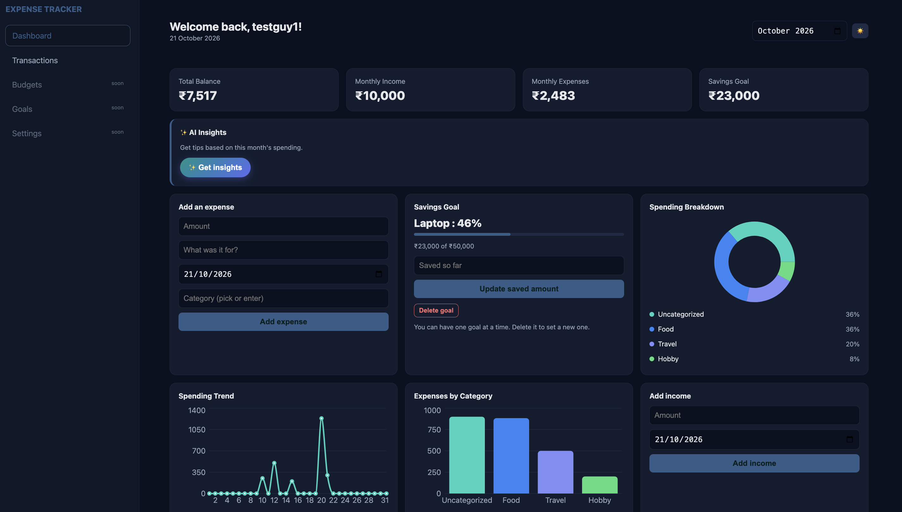

# expense-tracker-with-ai-insights

💰 Expense Tracker
A cozy little full-stack app to track where your money goes, with charts, budgets, savings goals, and AI tips. ✨

🌸 What it does
🔐 Sign up and log in securely
🧾 Add, view, and delete expenses (with categories you can create on the fly)
📊 Pretty charts: spending donut, category bars, and a daily trend line
🎯 Monthly budget with a progress bar
💵 Income tracking and total balance
🐷 One savings goal to cheer you on
🤖 AI insights that explain your month in plain words
🌙 Dark and light mode
🛠️ Built with
Frontend
React, Vite, Recharts
Backend
Node.js, Express
Database
SQLite
Auth
JWT + bcrypt
AI
Google Gemini API
🚀 Run it
You need Node.js 20 or newer.

1. Backend
   cd backend
   npm install
   ​
   Create backend/.env:
   PORT=3000
   JWT_SECRET=pick_a_long_random_string
   GEMINI_API_KEY=your_key_here
   GEMINI_MODEL=your_model_name
   ​
   npm run dev
   ​
2. Frontend (in a second terminal)
   cd frontend
   npm install
   npm run dev
   ​
   Open http://localhost:5173 and you're in! 🎉
   🗂️ Folders
   backend/ Express API, SQLite database, AI helper
   frontend/ React app (pages, components, charts)
   ​
   🔒 Good to know
   Never commit your .env file or expenses.db.
   Only totals and category names are sent to the AI, never descriptions or emails.
   🧭 Coming soon

New login page design

Budgets, Goals, and Settings pages

Saved AI insights

Deploy it!
Made with curiosity and lots of debugging 🐛💛
